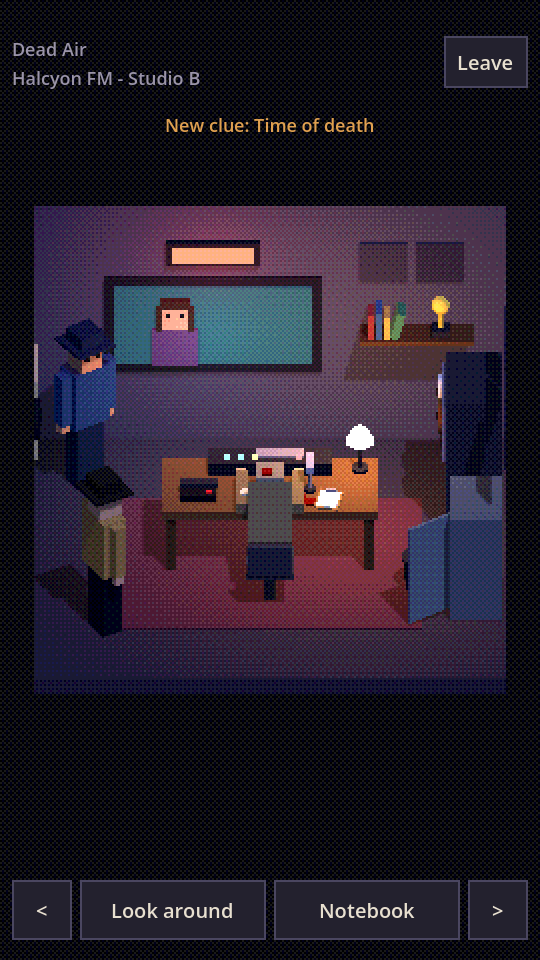
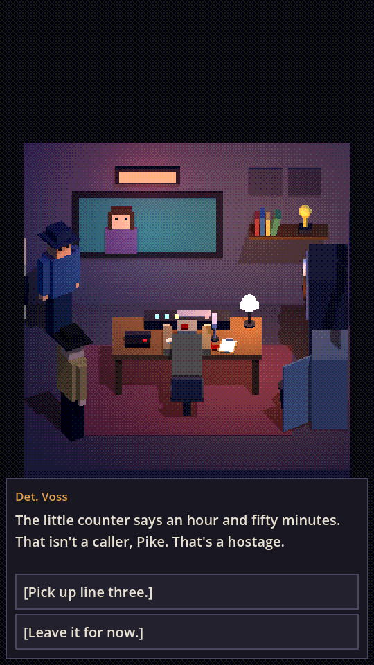
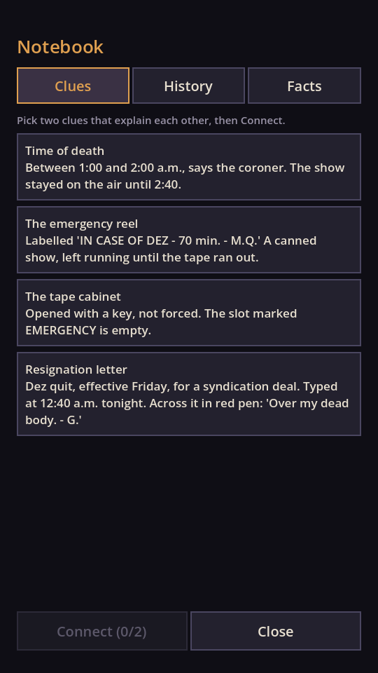

# Night Desk

A portrait point-and-click detective game for Android, made with Godot 4.7 and GDScript.
Low-poly 3D rooms are drawn at low resolution and scaled up, so they read as pixel art.

*Night Desk* is a working title.

| Room | Dialogue | Notebook |
|---|---|---|
|  |  |  |

## Running it

Open the folder in Godot 4.7 or later (the Android editor works) and press Play.

- **Tap** something to examine it.
- **Swipe sideways**, or use the arrows, to turn and face the next wall.
- **Look around** labels everything worth tapping.
- **Notebook** holds your clues. Pick two and **Connect** them to make a deduction.

## What's in the box

- **Case 1, "Dead Air"**: one room, 15 things to examine, 11 clues, 3 deductions,
  two people to question, three endings. About 15 minutes.
- **Detectives**: each one you create is a separate version of the world.
  Everything they choose is kept, across every case they work.
- **Cases are data**: a case is a folder of JSON files. No code is needed to add one.

## Layout

| Path | What it is |
|---|---|
| `core/game_state.gd` | The detective's save: facts, clues, history, conditions, effects |
| `core/case_db.gd` | Finds and loads cases, including add-on cases |
| `core/dialogue_runner.gd` | Runs dialogue; no UI inside |
| `core/room.gd`, `core/people.gd` | Build a 3D room and its people from JSON |
| `game/` | The play screen, dialogue box and notebook |
| `scenes/main.gd` | Menus and detective creation |
| `cases/dead_air/` | The first case |
| `tools/check.tscn` | Checks all case files and plays the case through by script |
| `docs/` | Design notes and the guide to writing cases |

## Checking your changes

```
godot --headless res://tools/check.tscn
```

It reports broken links between dialogue nodes, unknown clues, conditions that
don't parse, and then plays "Dead Air" to two of its endings.

## Exporting an APK

Case files are JSON, which Godot leaves out of exports by default. In the export
preset, under **Resources**, set "Filters to export non-resource files" to `*.json`.
